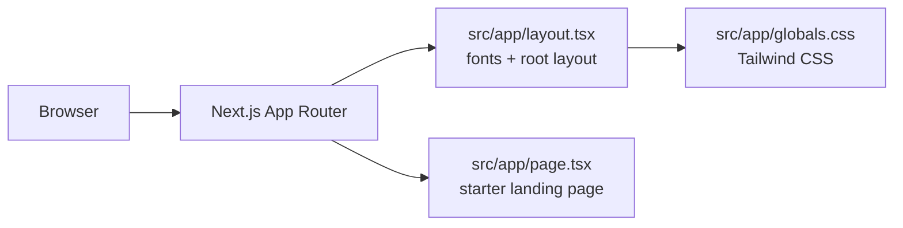

<h1 align="center">🪨 RockedIn</h1>
<p align="center">🏆 <b>3rd place · Qwen Brainrot Hackathon, Kuala Lumpur</b><br/><sub><a href="https://my.linkedin.com/in/yu-hang-chok-5ab0b4298">Award announcement</a></sub></p>
<p align="center"><b>LinkedIn, but for rocks.</b><br/><sub>Professional networking reaches a new geological era.</sub></p>

## ▍Project gallery

<table><tr>
<td width="50%"></td>
<td width="50%"></td>
</tr></table>

<sub>Images from the [project portfolio](https://bede-lau.github.io/); they may depict an earlier build.</sub>


## ▍The project

RockedIn is a satirical professional network for rocks, built for the Qwen Brainrot Hackathon. The project placed third; the pitch came with actual rocks.

> **Repository status:** the current default branch contains the untouched Next.js starter, not the award-winning application's implementation. The project description above describes the hackathon entry; the setup and architecture below describe the code currently in this repository.

## ▍What is in this repository



| Layer | Current implementation |
| --- | --- |
| Framework | Next.js 16 App Router, React 19, TypeScript |
| Styling | Tailwind CSS 4 and Geist fonts |
| Application | Default starter screen; no rock profiles, feed, backend, or AI integration is present on this branch |

## ▍Run locally

```sh
npm ci
npm run dev
```

Open [localhost:3000](http://localhost:3000). Use `npm run lint` for linting and `npm run build` to create a production build.

## ▍Repository map

```text
src/app/page.tsx     Starter page
src/app/layout.tsx   Root layout and font configuration
src/app/globals.css  Global styles
public/              Default static assets
```

The actual hackathon build may live elsewhere; this branch is not evidence of its feature set or deployment architecture.
