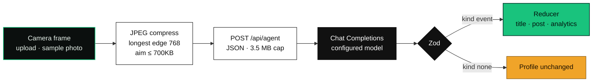
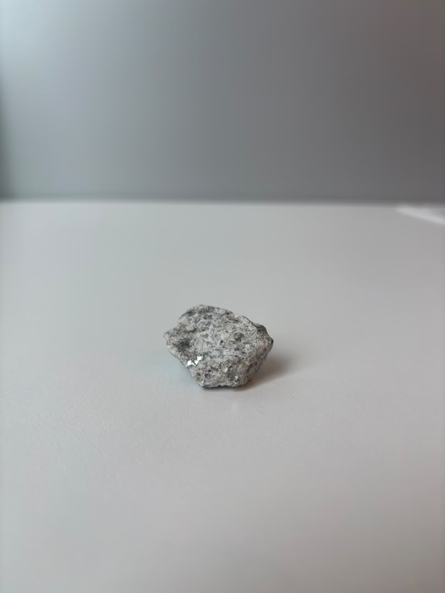
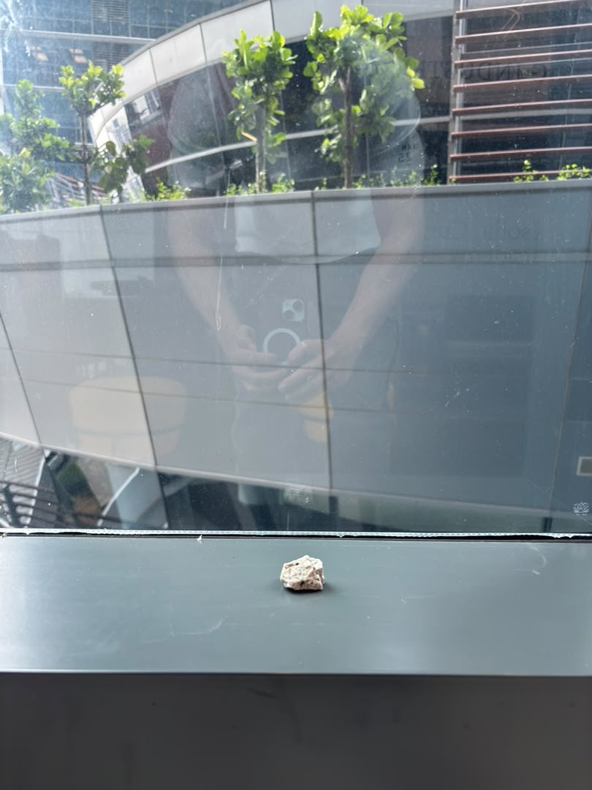
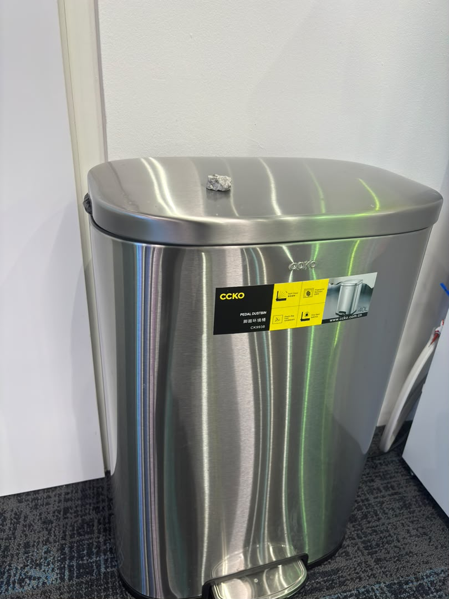
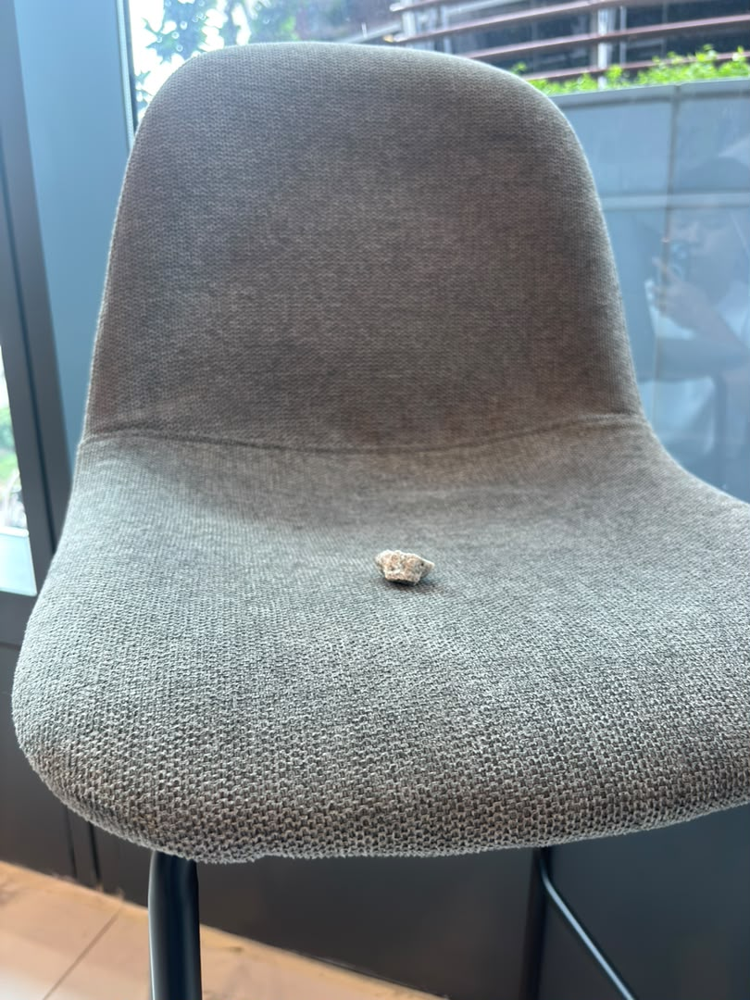

<p align="center"></p>

<p align="center">
  <b>🏆 3rd place · Qwen Brainrot Hackathon</b>
</p>

<p align="center">
  <b>LinkedIn for rocks.</b><br/>
  <sub>One profile: Batu Bin Granite. A photo becomes one validated career event. Next.js 16 · Chat Completions · Zod.</sub>
</p>

<p align="center">
  
  
  
  
  
  
</p>

---

## ▍The problem

Batu Bin Granite does not apply for jobs. He is a rock. Someone has to move him, then photograph where he landed.

RockedIn keeps one profile for him and treats that photo as a career event. The page title is "RockedIN | Every position is a new position." He starts as **Unemployed Mineral**, headline "Open to Work. Closed to Movement.", in Kuala Lumpur, with 4.5 billion years of experience. Those values are the seed in `src/lib/seed.ts`.

The model is told to stay serious. It may describe only what is visible. It may not give the rock arms, speech, or an action the photo does not show.

## ▍The pipeline



The browser sends the current image, the previous image when it has one, and a slice of profile state: the profile, the six most recent history items, certifications, connections, and analytics. The server checks the body, then calls the configured provider. OpenAI requests use `response_format: json_object`, `reasoning_effort: low`, and `max_completion_tokens`. ModelScope and Model Studio use `max_tokens`, and send `enable_thinking: false` only when that flag is on.

If the reply is not valid JSON, or it fails the Zod schema, the server makes one repair call. That call does not resend the image. It asks for a corrected object. A network failure or a retryable provider error is tried once more, after 750ms, on the first attempt only. Scene calls time out at 60 seconds by default. Review calls time out at 30 seconds. Both limits are configurable.

| Call | Route | What comes back |
| --- | --- | --- |
| **Scene** | `POST /api/agent` with `mode: "scene_event"` | `kind: "event"` or `kind: "none"`. An event carries a title, a 25–60 word post, up to four hashtags, up to three skills, an optional certification, an optional connection, exactly two comments, and numeric deltas. |
| **Review** | `POST /api/agent` with `mode: "human_review"` | A score from 0 to 100, three observations, a recommendation, a title for the human, a final title for Batu, and a post of at most 65 words. No image is sent. |
| **Health** | `POST /api/health` | Both configured models must return `{"status":"rock solid"}`. The route allows 35 seconds. |

`kind: "none"` means no primary rock was detected, or the image was unreadable. The profile is left as it was. The receipt still shows the scene summary.

On an event, `rockedinReducer` writes the new title and headline, prepends a history item and a post, and adds any new skill, certification, or connection. Analytics only move up, and they stop at the schema caps. `solidCount` on a scene post is `max(12, round(impressions delta × 0.18))`. The first new connection, while the profile is still under 500, raises the connection total to at least 500. The header then shows `500+`.

The client waits up to 125 seconds, the same cap as the agent route. While it waits, the capture panel steps through four labels, one every 760ms: "Inspecting physical position", "Translating gravity into growth", "Writing corporate humblebrag", "Updating living profile". The labels are a browser timer.

State is saved in `localStorage` under `rockedin-demo-state-v1`. Saved posts drop their image data. A saved receipt is marked `live: false`, so a reload says "Stored prior result".

## ▍The demo

The deployed app is [https://rockedin.onrender.com](https://rockedin.onrender.com).

This repository has no screenshots of the interface. It does have four sample photos. The home page lists `public/sample-images` from disk, in alphabetical order, and turns each filename into the button label. They are inputs. The repo does not store the model's reading of them.

<table>
  <tr>
    <td width="50%" align="center">
      
      <br/>
      <b>Neutral rock.</b> <code>neutral_rock.jpeg</code>
    </td>
    <td width="50%" align="center">
      
      <br/>
      <b>Rock aurafarming.</b> <code>rock_aurafarming.jpeg</code>
    </td>
  </tr>
  <tr>
    <td width="50%" align="center">
      
      <br/>
      <b>Rock on bin.</b> <code>rock_on_bin.jpeg</code>
    </td>
    <td width="50%" align="center">
      
      <br/>
      <b>Rock on chair.</b> <code>rock_on_chair.jpeg</code>
    </td>
  </tr>
</table>

Accepted sample types are `.jpg`, `.jpeg`, `.png`, and `.webp`. A numeric prefix is stripped from the label. Add a file, then rebuild.

**On the page:** **Capture & Promote** grabs a camera frame. After a preview is selected the same button reads **Promote This Position**. **Upload Photo Instead** and **Sample Photos** join that same path. **Review My Human** runs the finale. **Test service** calls `/api/health`. **Reset Demo**, and the Shift+R shortcut, restore the seed after a confirm. The header icon toggles presentation mode through the Fullscreen API, and falls back to a CSS class if that call fails.

The prompt lists example readings (a rock on a chair as "Seated Person", stacked books as "Upper Management", a second rock as networking). It also tells the model to invent a title for any other readable scene with Batu.

## ▍Run it

Node 20.9 or newer. That is the engine range declared by the locked `next@16.2.11`.

```sh
npm install
npm run dev
```

Open [http://localhost:3000](http://localhost:3000). The dashboard renders from the seed with no key. **Capture & Promote**, **Review My Human**, and **Test service** need a credential on the server.

```sh
cp .env.example .env.local
```

`.env.example` selects OpenAI, with `gpt-5.6-luna` for both the scene call and the review call:

```env
QWEN_PROVIDER=openai
OPENAI_API_KEY=
QWEN_BASE_URL=https://api.openai.com/v1
QWEN_SCENE_MODEL=gpt-5.6-luna
QWEN_REVIEW_MODEL=gpt-5.6-luna
QWEN_JSON_MODE=response_format
QWEN_SEND_THINKING_CONTROL=false
```

Leave the key empty in git. The server reads `OPENAI_API_KEY`, or `MODELSCOPE_API_TOKEN` / `DASHSCOPE_API_KEY` / `QWEN_API_KEY` for the other tuples. Do not prefix any of them with `NEXT_PUBLIC_`. Provider, base URL, and credential are checked as one tuple. A generic `QWEN_API_KEY` is refused until `QWEN_PROVIDER` or an official `QWEN_BASE_URL` is set. Commented ModelScope and Model Studio blocks, including their default model ids, are in `.env.example`.

| URL | What |
| --- | --- |
| `/` | The dashboard |
| `POST /api/agent` | Scene event or human review. `maxDuration` is 125 seconds. |
| `POST /api/health` | Both models. `maxDuration` is 35 seconds. |

Deploy it as a Node server. `next.config.ts` does not set a static export. Set the provider tuple in the host environment. Put the proxy body limit above 3.5 MB so the route can enforce its own cap.

```sh
npm run lint
npm run typecheck
npm run verify
npm run build
npm start
```

`npm run verify` runs lint, `tsc --noEmit`, and three scripts: `verify:request`, `verify:state`, and `verify:qwen`. They check the body-size reader, the reducer, and provider routing, using fixture strings in the scripts. There is no `npm test` script.

## ▍Repository map

```
rockedin/
├── src/app/page.tsx                  lists sample images, renders the app
├── src/app/layout.tsx                title, description, Geist fonts
├── src/app/api/agent/route.ts        scene event and human review
├── src/app/api/health/route.ts       both models must answer "rock solid"
├── src/components/RockedInApp.tsx    profile, post, receipt, finale
├── src/components/CameraCapture.tsx  camera, upload, sample dialog
├── src/lib/prompts.ts                scene prompt and HR prompt
├── src/lib/qwen.ts                   Chat Completions, repair, health
├── src/lib/qwen-config.ts            provider tuple and timeouts
├── src/lib/schemas.ts                Zod request and response contracts
├── src/lib/state.ts                  reducer
├── src/lib/seed.ts                   starting profile
├── src/lib/storage.ts                localStorage, images removed
├── src/lib/image.ts                  canvas JPEG compress
├── scripts/verify-*.ts               request body, reducer, routing
├── public/logo/rockedin-logo.png     header wordmark, 244×58
└── public/sample-images/             four committed photos
```

| Doc | |
| --- | --- |
| [DESIGN.md](DESIGN.md) | Layout, copy, and interaction constraints for the dashboard |
| [.env.example](.env.example) | OpenAI example, plus ModelScope and Model Studio alternatives |
| [public/logo/README.md](public/logo/README.md) | Keep the logo filename `rockedin-logo.png` |
| [public/sample-images/README.md](public/sample-images/README.md) | How sample filenames become labels |

`public/file.svg`, `public/globe.svg`, `public/next.svg`, `public/vercel.svg`, `public/window.svg`, and `public/qwen-logo.jpg` are leftover files. The app does not load them.

## ▍What this is, and isn't

We'd rather be precise than impressive.

- One browser profile. No accounts, no database, no photo library. `DESIGN.md` lists those as non-goals.
- With empty `localStorage`, the header shows the seed: 499 connections, 0 thoughts, 184g, 12 profile views, 31 impressions, 99.99% inactivity uptime.
- Scene events change the title, headline, skills, history, posts, and the analytics the model sends deltas for. Thoughts, net worth, location, experience, and inactivity uptime stay at the seed.
- Comments are generated text, two per scene post. "Solid", "Groundbreaking", and "Hard Agree" are labels on the post.
- The human-review post hardcodes its two comments, the hashtags `#Leadership` and `#PerformanceManagement`, `solidCount` 184, and the headline "Managing human capital through disciplined inertia." The score, observations, recommendation, and the two titles come from the model. Career level is then set to the top of a 0–7 range.
- `CAREER_STAGES` in `src/lib/state.ts` supplies that 0–7 cap. The ladder on screen is history titles, eight at most.
- A failed or rejected call keeps the current profile. Reset is the way back to the seed.
- There is no recorded model output in the repo. Running the demo spends a real provider call.

## ▍Credits

| | |
| --- | --- |
| App | [Next.js](https://nextjs.org) 16.2.11, [React](https://react.dev) 19.2.4, React Compiler enabled in `next.config.ts` |
| UI | [Tailwind CSS](https://tailwindcss.com) 4, classes in `src/app/globals.css`, [Lucide](https://lucide.dev) icons, [Geist](https://vercel.com/font) via `next/font` |
| Contracts | [Zod](https://zod.dev) 4, [TypeScript](https://www.typescriptlang.org) 5.9 |
| Models | OpenAI Chat Completions. The committed example uses `gpt-5.6-luna` for scene and review. Optional: ModelScope `Qwen-Ambassador/Qwen3.7-Plus` and `Qwen-Ambassador/Qwen3.7-Max`, or Alibaba Cloud Model Studio `qwen3.7-plus` and `qwen3.7-max` |
| Samples | Four photos in `public/sample-images/` |

<p align="center"><sub>Qwen Brainrot Hackathon · Next.js 16</sub></p>
